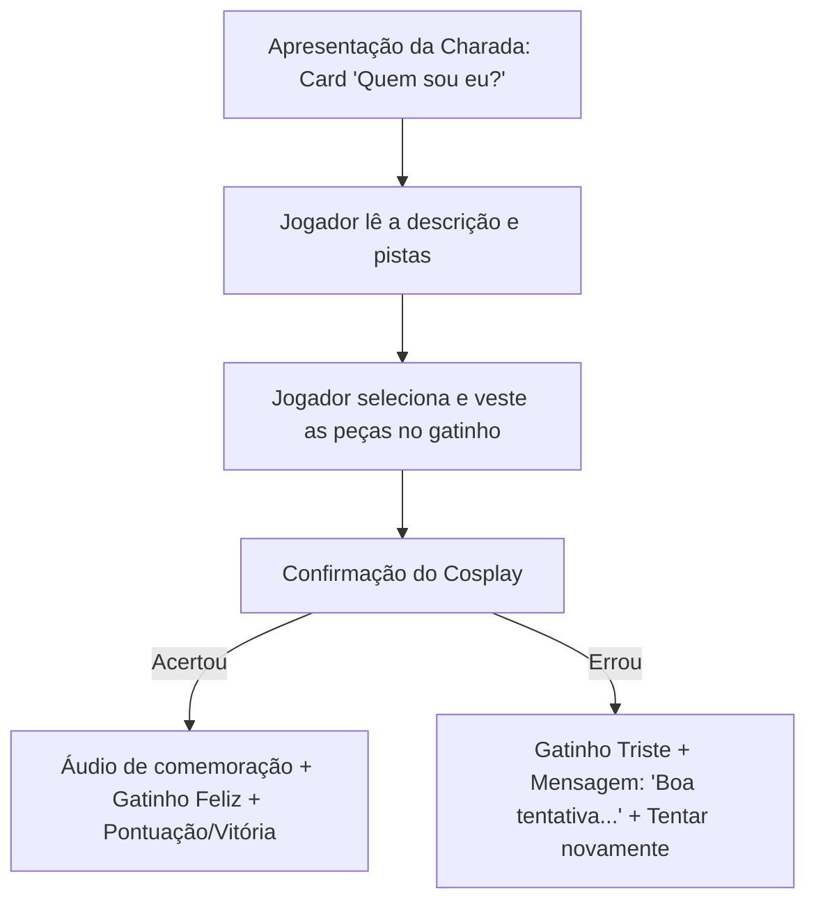

# Documento de Conceito: Gato Cosplay (Nome Provisório)

## 1. Visão Geral
- **Gênero:** Puzzle / Trivia / Dress-Up (Adivinhação e Customização)
- **Tema:** Personagens da cultura pop / anime representados como cosplay em um mascote felino.
- **Público-alvo:** Fãs de animes, jogos, cultura pop e jogos casuais/fofos.
- **Divisão de Papéis:**
  - **Arte e Design:** Cris Alves (ilustração do mascote base, expressões, roupinhas e acessórios de frente).
  - **Programação e Lógica:** Bruno (mecânicas de arrastar/equipar, verificação de acerto/erro, áudio e interface).

---

## 2. Core Loop (Ciclo Principal de Gameplay)

1. **Apresentação do Desafio:** O jogador recebe um card com uma charada descritiva ("Quem sou eu?").
2. **Seleção de Roupinhas/Cosplay:** Um armário/inventário de peças (roupas, perucas, chapéus, armas/adereços) é exibido.
3. **Vestir o Mascote:** O jogador equipa as peças no gatinho visto em visão frontal.
4. **Validação:**
   - O jogador clica em "Confirmar" ou "Adivinhar".
   - O sistema valida se o conjunto de peças corresponde ao personagem descrito.

---

## 3. Mecânicas Detalhadas

### 3.1. Card de Pistas ("Quem Sou Eu?")
- Uma charada com referências marcantes à história ou características do personagem.
- **Exemplo real do áudio (Inuyasha):**
  > *"Estive preso em uma árvore por uma flecha por tanto tempo até uma colegial me salvar."*

### 3.2. Sistema de Dress-up (Vestimenta)
- **Mascote Base:** Gatinho em perspectiva frontal neutra.
- **Camadas de Itens (Slots):**
  - Cabeça / Peruca (ex: orelhas de cachorro branco, cabelo prateado).
  - Roupa / Traje (ex: quimono vermelho hakama).
  - Acessório / Arma (ex: espada Tessaiga / colar de pérolas).
- Podem haver itens "distratores" (peças de outros personagens misturadas para aumentar o desafio).

### 3.3. Estados de Feedback

| Resultado | Reação Visual do Gatinho | Feedback Sonoro | Mensagem de Texto |
| :--- | :--- | :--- | :--- |
| **Acerto** | Rostinho feliz / pose de vitória | Som positivo de celebração (jingle/fanfarra) | *"Parabéns! Você descobriu o personagem!"* |
| **Erro** | Rostinho triste / carinha manhosa | Som sutil de falha | *"Boa tentativa, mas não sou este personagem."* |

---

## 4. Oportunidades de Expansão Futura

1. **Galeria de Cosplays (Álbum):** Cada personagem acertado é salvo em uma galeria com foto estilo Polaroid.
2. **Níveis de Dificuldade / Dicas:**
   - Dica 1: Letra inicial do personagem ou anime.
   - Dica 2: Eliminar 2 peças erradas do inventário.
3. **Temáticas e Categorias:**
   - Animes clássicos anos 90/2000.
   - Games retrô.
   - Heróis e cinema.
4. **Modo Contrarrelógio ou Modo Memória:** Variação sugerida nos áudios para testar rapidez de raciocínio.
