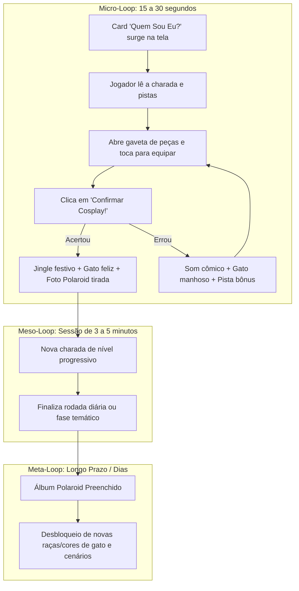

# Game Design Document: Dinâmica, Retenção e Fluxo do Jogador
> **Projeto:** Gato Cosplay  
> **Plataformas-Alvo:** Mobile Web, Android App (prioridade máxima) e Desktop Web  
> **Foco:** Mecânicas casuais, retenção por colecionismo e ergonomia para toque (touch-first).

---

## 1. Pilares de Design e Identidade

1. **Acessibilidade Instantânea (Pick-up and Play):** Qualquer pessoa compreende a proposta em menos de 5 segundos. Ler, reconhecer a pista da cultura pop e vestir o gatinho.
2. **Fator Fofura e Humor (Cat Kawaii + Cosplay):** O charme do jogo está em ver um felino fofinho trajando roupas icônicas e reagindo com expressões engraçadas quando o jogador acerta ou erra.
3. **Colecionismo como Motor de Retenção (Álbum Cosdex):** O desejo de completar o álbum de fotos polaroids é o que faz o jogador voltar todo dia.
4. **Ergonomia para o Polegar (Thumb Zone):** Interface desenhada para ser jogada com apenas uma mão no celular na vertical (Modo Portrait 9:16).

---

## 2. O Core Loop (Ciclo Principal de Gameplay)



---

## 3. Mecânicas Detalhadas

### 3.1. Apresentação do Desafio (O Card da Charada)
* Ao iniciar uma rodada, o card superior exibe uma charada bem-humorada com referências à história, bordões ou características do personagem.
* **Exemplo 1 (Inuyasha):**  
  > *"Fui selado em uma árvore sagrada por uma flecha mística até que uma colegial que viajou no tempo me libertou. Quem sou eu?"*
* **Exemplo 2 (Sailor Moon):**  
  > *"Sou uma estudante estabanada e chorona que luta pelo amor e pela justiça em nome da Lua! Quem sou eu?"*
* **Exemplo 3 (Naruto):**  
  > *"Meu sonho é me tornar Hokage, amo lámen de porco e carrego uma raposa lendária dentro de mim. Quem sou eu?"*

### 3.2. Mecânica de Vestimenta: "Tap-to-Equip" (Otimizado para Celular)
Embora arrastar e soltar (Drag and Drop) pareça intuitivo em computadores, em telas pequenas de celular o dedo cobre a tela e cansa a mão.  
A melhor solução de interação para mobile é o **Tap-to-Equip**:
1. O jogador toca em uma peça no guarda-roupa inferior.
2. A peça voa suavemente com uma animação de escala (`spring/pop`) e se acomoda no slot correspondente do gatinho.
3. Se já houver uma peça naquele slot (ex: trocou peruca do Goku pela do Naruto), a peça antiga volta para o inventário e a nova assume o lugar.
4. Para remover um item vestido, basta tocar diretamente no gatinho sobre a peça.

### 3.3. Composição do Guarda-Roupa (Desafio e Distratores)
* Em cada rodada, o inventário exibe **6 a 8 peças misturadas**:
  * As **3 peças certas** do personagem da charada (Cabeça, Corpo, Acessório).
  * **3 a 5 peças distratoras** (itens de outros personagens ou itens cômicos avulsos).
* O jogador precisa identificar quais são as 3 peças certas e ignorar as falsas.

---

## 4. O Sistema de Retenção: Como Manter o Jogador Interessado

Para transformar um minigame simples em um jogo que as pessoas jogam todos os dias, usamos 4 motores de retenção comprovados no mercado mobile casual:

### 4.1. Álbum Cosdex (Fotos Estilo Polaroid)
* **O Efeito Flash:** Ao acertar o cosplay, a tela dá um flash branco suave, toca o som de obturador de câmera antiga `click-clack`, e uma foto Polaroid do gatinho uniformizado se materializa com uma dedicatória fofa (ex: *"Inu-Cat - Resgatado em 11/10"*).
* **Colecionismo Visual:** O jogador pode abrir o botão "Álbum" a qualquer momento e ver sua estante de polaroids preenchidas. Slots ainda não descobertos ficam como silhuetas escuras com um ponto de interrogação `?`, aguçando a curiosidade.
* **Botão Compartilhar:** Gera uma imagem compacta pronta para postar nos Stories do Instagram / WhatsApp com a legenda: *"Adivinhei quem é o cosplay de hoje no Gato Cosplay! 🐾"*.

### 4.2. Sistema de Dicas sem Frustração (Hint System)
Para evitar que o jogador trave e feche o jogo:
* **Dica Nível 1 (Pista de Texto):** Destaca o nome do anime ou ano de estreia da obra.
* **Dica Nível 2 (Vassourinha / Eliminação):** Faz 2 itens incorretos desaparecerem do armário com uma animação de fumaça, reduzindo a dúvida.
* **Recarga de Dicas:** O jogador começa com 2 dicas grátis e ganha 1 nova a cada 3 personagens acertados.

### 4.3. Desafio Diário & Streaks (O "Cosplay do Dia")
* Todo dia à meia-noite, um novo cosplay exclusivo é liberado para todos os jogadores do mundo.
* Um contador de sequência (*Streak de Patinhas* 🐾🔥) incentiva o jogador a entrar todos os dias para não perder o recorde.

### 4.4. Personalização do Mascote Base (Recompensa de Longo Prazo)
Ao completar páginas inteiras do álbum, o jogador desbloqueia opções para mudar o gato:
* Pelagem Siamês, Frajola, Laranja (Garfield), Preto ou Branco felpudo.
* Cenários novos (quarto gamer, convenção de cosplay, jardim japonês).

---

## 5. Ergonomia e Layout Mobile-First (9:16)

```text
+-------------------------------------------------------+
| [Header] Barra de Progresso (Ex: 3/5)  [Dica]  [Som]  |
+-------------------------------------------------------+
|                                                       |
|  [CARD DA CHARADA]                                    |
|  "Quem sou eu? Estive preso em uma árvore..."         |
|                                                       |
+-------------------------------------------------------+
|                                                       |
|                     /\_/\                             |
|                    ( o.o )   <-- [Área do Gatinho]    |
|                     > ^ <         (1024x1024 central) |
|                                                       |
+-------------------------------------------------------+
| [Abas Opcionais]: (Tudo) (Cabelo) (Roupa) (Itens)     |
| +----+  +----+  +----+  +----+  +----+                |
| |Item|  |Item|  |Item|  |Item|  |Item|  <-- Carrossel  |
| +----+  +----+  +----+  +----+  +----+      do Armário|
+-------------------------------------------------------+
|   [ ↺ Limpar ]          [ ★ CONFIRMAR COSPLAY! ★ ]    |
+-------------------------------------------------------+
```

### Adaptação Multiplataforma:
* **Mobile (Web e Android App):** O jogo ocupa 100% da altura e largura da tela vertical, com botões dimensionados para área de toque confortável (mínimo de 48 × 48 px por botão).
* **Desktop Web:** Em monitores widescreen (16:9), o jogo é renderizado centralizado dentro de uma moldura estilizada vertical (estilo tela de smartphone retrô ou máquina gashapon), com o fundo do site exibindo um padrão acolhedor com patinhas. Não distorce a arte e mantém a mesma experiência em qualquer tela.

---

## 6. Arquitetura de Dados (Para a Programação do Bruno)

A estrutura de dados pode ser mantida em um arquivo simples `characters.json` que facilita adicionar centenas de novos cosplays sem alterar o código do jogo:

```json
[
  {
    "id": "inuyasha",
    "name": "Inuyasha",
    "anime": "Inuyasha (Rumiko Takahashi)",
    "riddle": "Fui selado em uma árvore sagrada por uma flecha mística até que uma colegial me libertou com um espirro e muita confusão!",
    "hint": "Anime clássico exibido no Cartoon Network e na TV aberta nos anos 2000.",
    "requiredPieces": {
      "head": "cosplay_inuyasha_head",
      "body": "cosplay_inuyasha_body",
      "item": "cosplay_inuyasha_item"
    },
    "distractors": [
      "distractor_straw_hat",
      "cosplay_naruto_head",
      "distractor_magic_wand"
    ]
  }
]
```

### Validação da Vitória:
* Quando o jogador pressiona **Confirmar**:
  ```javascript
  const isHeadCorrect = currentSlots.head === character.requiredPieces.head;
  const isBodyCorrect = currentSlots.body === character.requiredPieces.body;
  const isItemCorrect = currentSlots.item === character.requiredPieces.item;

  if (isHeadCorrect && isBodyCorrect && isItemCorrect) {
    triggerVictory(character);
  } else {
    triggerFailure({ head: isHeadCorrect, body: isBodyCorrect, item: isItemCorrect });
  }
  ```
* Se o jogador acertou 2 de 3 peças, o gatinho pode dar um feedback visual especial: inclinar a cabeça em dúvida e soltar uma dica sutil (ex: *"Quase lá! Algo na minha roupa parece estranho..."*).

---

## 7. Estratégia de Deploy: Web e Android

1. **Desenvolvimento Principal:** HTML5 / CSS3 / JavaScript moderno com Vite ou Vanilla. 
2. **Áudio e Efeitos:** Web Audio API (jingles de vitória, som de miado fofo, som de papel rasgando/polaroid).
3. **Android App (APK / Google Play):**
   - Utilização do **Capacitor** (`@capacitor/core` e `@capacitor/android`).
   - Vantagens: Roda a mesma base web sem retrabalho, suporta tela cheia nativa, vibração de feedback táctil (`Haptics`) e armazenamento local do progresso do jogador (`Preferences`).
